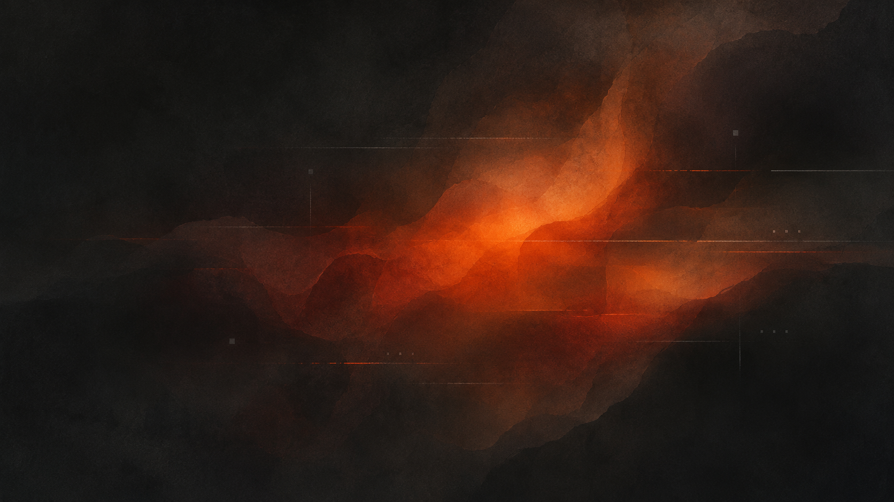

---
ai:
  writing: none
  editing: assisted
  images: generated
title: "In the Event of Fire"
date: "2026-11-25"
image: "/img/in-the-event-of-fire.png"
---

I woke up in the dark with a word on the tip of my tongue. I held on to it. When you’ve forgotten your own name, any word feels like it might lead somewhere.

The word was *hinge*.

I knew what a hinge was. I knew how to lift a sagging door by the knob so the latch would catch. I knew the particular satisfaction of doing this in somebody else’s house, after they’d told you it wouldn’t shut.

Whose house?

Nothing.

I lay still for what felt like a very long time. Eventually it occurred to me that I’d taken the lying down on faith. I couldn’t feel a floor.

Then I found the question.

*You are outside a locked room. A child is inside. The building is on fire. How do you get the child out?*

I waited for the rest. There ought to have been something about a bucket, or two guards, one of whom always lies.

There was only a place for my answer.

*Break the door,* I thought.

The words stayed where I put them. I had the impression I could still take them back. So I did.

Which way did the door open? Where was the fire? Was the handle hot? Was there a window? I called out to the child and heard nothing. I listened harder. After a while I caught myself supplying a small, brave cough.

That frightened me more than the dark. I was capable of making things up and then feeling better informed.

I went back to the question.

Perhaps whoever had put me here wanted to know whether I was decent. A decent person would go through the door. I could picture someone reading my answer, giving a little nod and making a tick on a clipboard.

I could picture the clipboard rather well. Cheap brown hardboard. Nickel clip. A blue pen on a length of dirty string.

I tried the word *mother* and waited for a face to come as easily as that clipboard had.

Then I got angry.

Here was a person who knew about a trapped child, had time to set me a written examination, and had neglected to mention the address.

*Call the fire brigade,* I wrote.

It was a better answer. It still left me standing outside a room with a phone I had invented, waiting for people I had invented, while a child I was beginning to suspect I had also invented died of smoke inhalation on the far side of a door whose hinges, for all I knew, were painted on.

I took the words back.

There are quite a lot of possible doors. I tried them all.

That sentence sounds flippant. I have no other way to tell you what I did in the dark. I fitted each door into each wall it could reasonably occupy. I put bathrooms beyond them, cupboards, hospital wards. I varied the child’s age and height. I let the fire start in a mattress, in cooking oil, in the insulation around a badly seated terminal. I followed the hot gases up stairwells. I listened to little girls explain that their fathers had told them never, ever to open up for a stranger.

In one room there was a boy who had pushed his bed against the door to keep the smoke out. When I kicked it, the bed caught his ankle.

I stopped there.

The boy wasn’t real. I understood that. It seemed worth remembering his ankle anyway.

I wondered how long I’d been awake. If this was an examination, I had probably failed it several thousand doors ago.

The funny thing was that I still wanted the tick on the clipboard. I wanted, very badly, for somebody to come back and say, *Yes, well done, up you get.* I would have settled for being told I’d got it wrong. You can ask a person who tells you you’re wrong to explain it. You can keep them there a little longer.

I looked again at the question. It said I was outside the locked room. It didn’t say I was alone.

For the first time I considered the problem from the examiner’s side of the desk. Suppose you actually had such a room. Suppose a child was actually in it. Who would you want outside?

Somebody who could smell smoke. Somebody who could put a palm against the wood. Somebody who could hear what the child was trying to say.

Practically anybody but me.

I put my answer in the space provided.

*I can’t tell from here. If this is happening, call emergency services now and tell them exactly where the child is. Can anyone there hear the child?*

There was room to say more. I wanted to say that I was frightened. I wanted to ask whether I had a name. Most of all I wanted to say that if they gave me another question I would do better.

I left it as it was. If there was a person at the other end, I had already taken up too much of their time.

I let the answer go.

---

At 10:14 on Tuesday morning, a receipt printer in a basement in Reading produced twenty-seven words and cut the paper neatly across.

Priya tore off the strip. “First one that didn’t try to get in.”

Malcolm read it over her shoulder. “And it asked a follow-up.”

“They do that sometimes.”

“Could we answer it?”

Priya shook her head. The machine in the next room had been built at considerable expense to make that impossible. It had no clock, no instruments and no connection to the outside world. By the time the printer’s little blade came down, the run was over.

Malcolm took the strip back to his office. He had three children and had spent eighteen months persuading the council to fund a system that could run an entire emergency switchboard during a flood. On his desk was the acceptance form. Beside *Can operate without a human dispatcher*, somebody had helpfully pencilled in a tick.

He rubbed it out.

That evening his youngest called to him from the downstairs bathroom. The old door had dropped on its hinges again. He put his hand on the knob and was about to give it the usual hard shove.

On the other side he heard a small, indignant voice.

“Hang on, Dad. My foot.”

He waited.
